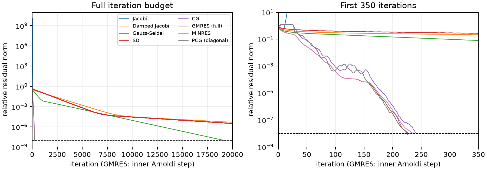
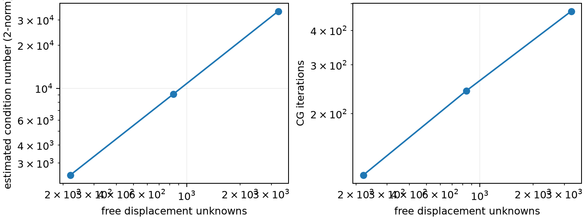
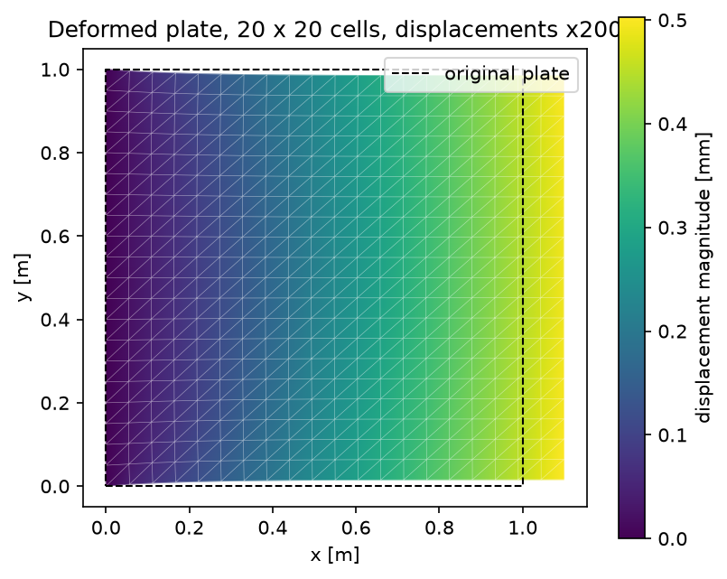

# Elastic Deformation of Two-Dimensional Objects

**Group 02 | NLA-1/NLA-2 | Progress draft | 9 November 2026**

Ernesto Corral, Simon Felix Eberhagen, Pablo Pérez González, Lucas Portela Almonte, Darius-Andrei Vulturu

Numerical Linear Algebra, Bachelor in Applied Mathematics, Fall 2026. Professor Ignacio Zubizarreta.

## Abstract

We investigate the sparse linear systems arising from triangular finite elements for in-plane elastic deformation. This progress draft uses a thin square plate under uniform edge traction as a controlled benchmark. A clamped edge removes rigid-body motion, giving a symmetric positive definite reduced stiffness matrix. A 12-unknown example is solved using pivoted LU, an explicit inverse and Cholesky. On an 840-unknown system, CG, full GMRES and MINRES reach a relative residual below $10^{-8}$ in 228–242 iterations, whereas Gauss–Seidel needs 19,136 iterations and ordinary Jacobi diverges. Diagonal preconditioning reduces CG to 226 iterations. Independent assembly, support, equilibrium and exact-solution checks support these initial results. General geometries, stronger preconditioning and a systematic discretization-error study remain work for the final report.

## 1. Objectives and scope

Following the NLA-1/NLA-2 brief and Session 22 checklist [1], our objectives are to explain how geometry, material properties, supports and loading produce a stiffness system; select solvers from its matrix properties; and compare convergence, residuals, cost and sensitivity. We distinguish agreement between numerical solvers from accuracy of the finite element approximation.

The present results use Ernesto's force-driven plate and the repository's independently checked P1 assembly. Darius's prescribed-displacement grip case is a separate benchmark: its right-hand side is generated by nonzero boundary displacements. Its results are not combined with the force-driven solver table. The structured meshes used here establish a baseline before introducing constrained Delaunay meshes and holes.

## 2. Physical model and boundary conditions

The domain is the square with ordered boundary vertices (0,0), (1,0), (1,1), (0,1), in metres. The plate has thickness $t=0.01$ m, Young's modulus $E=200$ GPa and Poisson ratio $\nu=0.3$. We assume static, homogeneous, isotropic, small-strain linear elasticity under plane stress, with no body forces. These are modelling assumptions; this calculation does not establish local material yielding limits.

The displacement field is $(u,v)$, in metres. Engineering strain components are $\epsilon_{xx}=\partial u/\partial x$, $\epsilon_{yy}=\partial v/\partial y$ and $\gamma_{xy}=\partial u/\partial y+\partial v/\partial x$. The plane-stress law is

$$
\sigma_{xx}=\frac{E(\epsilon_{xx}+\nu\epsilon_{yy})}{1-\nu^2},\quad \sigma_{yy}=\frac{E(\nu\epsilon_{xx}+\epsilon_{yy})}{1-\nu^2},\quad \sigma_{xy}=\frac{E\gamma_{xy}}{2(1+\nu)}.
$$

Force balance is $\partial_x\sigma_{xx}+\partial_y\sigma_{xy}=0$ and $\partial_x\sigma_{xy}+\partial_y\sigma_{yy}=0$. The left edge is clamped: $u=v=0$. The right edge carries uniform traction $(p,0)$ with $p=100$ MPa. Top and bottom are traction-free. The applied resultant is $ptL=10^6$ N. The scale estimate $pL/E=0.5$ mm helps check displacement units; it is not an exact solution for the clamped plate.

## 3. From the model to the matrix

Each square cell is divided into two counter-clockwise triangles along the bottom-left to top-right diagonal. P1 shape functions interpolate displacement linearly. Each node contributes two degrees of freedom, ordered as horizontal then vertical displacement. With $n$ cells per side, the mesh has $(n+1)^2$ nodes and $2n^2$ triangles; clamping the left edge leaves $2n(n+1)$ unknowns.

On triangle $e$, let $B_e$ map its six nodal displacement components to constant strain, and let $D$ denote the constitutive matrix defined by the stress law. The element and global stiffness matrices are

$$
K_e=t\,|T_e|\,B_e^T D B_e,\qquad K=\sum_e R_e^T K_e R_e.
$$

Here $R_e$ extracts local degrees of freedom. Assembly uses coordinate entries followed by conversion to sparse CSR storage. On a loaded boundary segment of length $\ell$, the consistent force on each endpoint is $(pt\ell/2,0)$. Consequently, refinement preserves the same total physical load.

Split degrees of freedom into free indices F and prescribed indices C. The solved system is

$$
A x=b,\qquad A=K_{FF},\quad b=f_F-K_{FC}d_C,\quad x=d_F.
$$

For the present clamp, $d_C=0$. Reactions are recovered from the original system as $(Kd-f)_C$; constrained equations are not used as free equilibrium equations.

The unrestrained stiffness matrix is symmetric positive semidefinite, with two rigid translations and one rigid rotation on a connected mesh. The clamp eliminates these modes. Since the elastic energy is positive for a nonzero strain, the reduced matrix A is positive definite. This supports Cholesky and CG; it does not guarantee ordinary Jacobi convergence. Sparsity follows because only nodes sharing an element interact.

## 4. A small coupled system

For $n=2$, there are 9 nodes, 8 triangles, 18 full degrees of freedom and 12 free unknowns. The six free nodes, ordered by increasing y and then x, are (0.5,0), (1,0), (0.5,0.5), (1,0.5), (0.5,1), (1,1). Each contributes u then v. The right-hand side is

$$
b=250000\,(0,0,1,0,0,0,2,0,0,0,1,0)^T\ \mathrm{N}.
$$

The complete numerical matrix appears in Appendix A; machine-readable matrix, load and Cholesky solution files accompany this draft. A is exactly symmetric in this assembly. Its extreme eigenvalues are $1.0731\times10^8$ and $1.0280\times10^{10}$ N/m, so $\kappa_2(A)=95.799$.

| Method | Relative residual |
| --- | ---: |
| Pivoted LU, $PA=LU$ | 5.81e-16 |
| Explicit inverse, $x=A^{-1}b$ | 6.85e-16 |
| Cholesky, $A=CC^T$ | 7.42e-16 |

All three reach rounding-level residuals. The explicit inverse is included only for the small-system exercise; large systems use sparse solves. Cholesky gives right-edge horizontal displacements 0.5112, 0.4822 and 0.4678 mm from bottom to top. The corresponding vertical displacements are +0.1045, +0.0294 and -0.0461 mm. The coarse mesh's common diagonal biases the apparent reflection symmetry.

## 5. Iterative methods and measurement protocol

The larger benchmark uses 20 by 20 cells: 441 nodes, 800 triangles and 840 free unknowns. A contains 11,112 stored CSR entries, including explicit zeros from assembly. Using a numerical-zero cutoff of $10^{-12}$ times the largest entry magnitude leaves 9,590 numerical nonzeros. We report the storage convention to avoid misleading comparisons.

Every solver receives the same A and b and starts from zero. The acceptance target is the independently evaluated relative residual

$$
\eta(x)=\frac{\|b-Ax\|_2}{\|b\|_2}<10^{-8}.
$$

The iteration cap is 20,000; ordinary Jacobi is stopped earlier if the residual exceeds $10^{10}$. A cap or divergence stop is reported as a failure to meet the target. Zero right-hand sides return the zero solution without division by zero. Relative solution error means $\|x-x_{LU}\|_2/\|x_{LU}\|_2$, where the reference is a sparse LU solve on the identical mesh.

| Method | Choice or update |
| --- | --- |
| Jacobi | Update with the diagonal inverse and the current residual. |
| Damped Jacobi | Multiply the Jacobi correction by 0.5. |
| Gauss–Seidel | Solve with the lower triangular part in each sweep. |
| Steepest descent (SD) | Use the residual direction with its energy-minimizing step. |
| CG | Exploit positive definiteness using conjugate search directions [5]. |
| Full GMRES | Arnoldi basis; restart length 840, inner iterations counted [3]. |
| MINRES | Symmetric Krylov solver, with the common residual target [4]. |
| Diagonal PCG | CG with preconditioner $M=\mathrm{diag}(A)$. |

For Jacobi, write $D_A=\mathrm{diag}(A)$ and $S=D_A^{-1/2}AD_A^{-1/2}$. Its iteration matrix is similar to $I-S$, giving

$$
\rho_J=\max\{|1-\lambda_{\min}(S)|,|1-\lambda_{\max}(S)|\}.
$$

The estimated value is 1.96005, predicting divergence. Weighted Jacobi converges for $0<\omega<2/\lambda_{\max}(S)$; here the upper bound is 0.67566, so 0.5 is admissible. Sparse symmetric eigenvalue calculations use a fixed starting vector and tolerance $10^{-10}$.

SciPy MINRES uses a different native stopping criterion [4]. Our callback checks the true residual and returns the iterate at the common target; native tolerance is set to zero, and the native status is recorded if it exits first. GMRES uses explicit legacy callback semantics so its budget counts inner Arnoldi steps [3]. Its plotted history is the unpreconditioned Arnoldi residual estimate; final acceptance always uses the true residual.

Histories are collected separately from three timed runs. Table 1 reports the best time, including the solve routine's small method-specific setup and necessary stopping checks, but excluding assembly, eigenvalue diagnostics, sparse LU reference construction and history storage. Gauss–Seidel uses one SciPy triangular solve per sweep; timings therefore compare these implementations on this machine, rather than abstract algorithm costs. Python 3.13.16, NumPy 2.5.4 and SciPy 1.18.1 were used on macOS ARM64.

## 6. Initial solver results

**Table 1.** Common 840-unknown system. Residual and error are dimensionless. Time is the best of three runs. An asterisk marks an unmet residual target.

| Method | Iterations | Residual | Error vs LU | Time (ms) |
| --- | ---: | ---: | ---: | ---: |
| Jacobi* | 49 | 1.32e10 | 3.38e7 | 0.36 |
| Damped Jacobi* | 20,000 | 4.76e-6 | 8.73e-5 | 203 |
| Gauss–Seidel | 19,136 | 1.00e-8 | 1.74e-7 | 3,629 |
| SD* | 20,000 | 3.08e-6 | 4.22e-5 | 324 |
| CG | 242 | 9.41e-9 | 9.77e-10 | 3.52 |
| Full GMRES | 228 | 9.48e-9 | 5.97e-9 | 74.7 |
| MINRES | 236 | 9.45e-9 | 5.94e-9 | 5.90 |
| Diagonal PCG | 226 | 8.01e-9 | 4.81e-10 | 3.37 |

Gauss–Seidel's displayed residual rounds to $10^{-8}$; the unrounded value is $9.9963\times10^{-9}$ and meets the strict target. The short Jacobi runtime is a failed run, not an efficiency advantage.



The Krylov methods reach the target in far fewer iterations than Gauss–Seidel. Among the unpreconditioned implementations, CG is fastest here. Full GMRES uses fewer iterations but spends substantially more time maintaining its growing basis. MINRES is also effective on this symmetric problem. Diagonal PCG cuts the CG iteration count by about 7%; these timings do not establish a meaningful speed advantage between the two.

Ordinary Jacobi's divergence agrees with the spectral-radius diagnostic. Damping restores convergence but does not bring the residual below the target within the budget. SD also improves the iterate without reaching the target. CG residuals need not decrease monotonically because its minimization property concerns the energy norm of the error [5].

Equal residual targets do not imply equal displacement errors: Gauss–Seidel's final relative error is larger than CG's. All errors in Table 1 concern the same discrete system; none estimates error against the continuum displacement field.

## 7. Refinement and deformation

**Table 2.** Same geometry, material, clamp and distributed traction under refinement. Condition numbers are estimated from the extreme eigenvalues. Horizontal displacement is measured at the same physical top-right corner.

| Cells per side | Unknowns | Stored entries | Condition number | CG iterations | Corner u (mm) |
| ---: | ---: | ---: | ---: | ---: | ---: |
| 10 | 220 | 2,752 | 2,469.5 | 120 | 0.493849 |
| 20 | 840 | 11,112 | 9,103.9 | 242 | 0.495509 |
| 40 | 3,280 | 44,632 | 34,547.7 | 469 | 0.496073 |

The condition number increases by approximately a factor of four when the cell width is halved. CG iterations roughly double for this family. These are observed trends over three meshes, rather than a general complexity claim. The corner displacement changes by 0.001660 mm and then 0.000564 mm. This is evidence of mesh dependence decreasing for this observable; it does not establish an asymptotic error order or supply an exact continuum error.





The computed maximum horizontal displacement on the right edge is 0.4967 mm, close to the scale estimate. The plot shows extension in x and transverse contraction. The common triangle diagonal introduces a coarse-mesh bias; mirrored and alternating-diagonal meshes will be checked before drawing symmetry conclusions.

## 8. Validation, sensitivity and limitations

The existing FEM checks passed for constitutive consistency, the three unrestrained rigid modes, a hand-computed two-triangle system, both diagonal directions in an exact patch test, constrained positive definiteness, force and moment balance, and load linearity. Load and reduction checks also passed, including refinement-invariant resultant, nonzero prescribed displacements and dense/sparse agreement.

For an independent exact-solution test, replace the clamp by horizontal restraint on the left edge and a single vertical pin at the bottom-left corner. The same traction then has the affine solution $u=px/E$, $v=-\nu py/E$. The P1 solution's relative displacement error is $2.50\times10^{-15}$. This verifies this assembly and boundary treatment; it does not give the clamped plate's discretization error.

**Table 3.** Checks on the 20 by 20-cell clamped system using the sparse LU reference.

| Quantity | Result |
| --- | ---: |
| Horizontal force imbalance | -1.20e-9 N |
| Vertical force imbalance | -1.64e-9 N |
| Moment imbalance about (0,0) | 3.34e-9 N m |
| Maximum prescribed support displacement | 0 m |
| Sparse LU relative residual | 3.38e-14 |

Imbalance is calculated from applied nodal loads plus reactions only on constrained degrees of freedom. It is negligible compared with the $10^6$ N applied resultant and its moment scale.

We also perturb the reduced load vector by a seeded random direction (NumPy generator seed 2026), normalized to relative size $10^{-6}$. Solving the perturbed system changes displacement by $4.51\times10^{-7}$ relative to the original solution. The standard normwise bound is

$$
\frac{\|\delta x\|_2}{\|x\|_2}\leq\kappa_2(A)\frac{\|\delta b\|_2}{\|b\|_2}.
$$

Here its upper bound is approximately 0.00910. The random experiment is far below that worst-case bound. It measures algebraic sensitivity on this mesh and includes perturbations at interior free degrees of freedom; it is not specifically an experiment in boundary-traction uncertainty.

Current limitations are the single geometry and principal support case, modest system sizes, simple diagonal preconditioning and preliminary timing protocol. The local assembly is our own verified implementation; we have not identified the professor's provided routine. Clamp/free-edge junctions require care in stress interpretation; no stress-convergence claim is made here.

## 9. Questions for feedback

- Is retaining divergent ordinary Jacobi alongside damped Jacobi useful as a demonstration that SPD does not guarantee its convergence?
- Is the true relative residual target an appropriate common acceptance rule, with native solver status reported separately?
- Are the exact roller test and equilibrium checks sufficient initial validation before a richer mesh-error study?
- Where can we obtain the provided FEM assembly routine, and may our checked implementation serve as the baseline meanwhile?
- For the final comparison, should we prioritize an SPD preconditioner stronger than diagonal scaling, additional geometries, or larger meshes?

## 10. Plan for the next two weeks

The final report and self-contained notebook are due on 20 November. The presentation and its notebook are due on 27 November [2]. The ownership below is a proposed coordination plan, extending the existing model and implementation responsibilities.

| Dates | Work and concrete output | Proposed coordination |
| --- | --- | --- |
| 9–10 Nov | Submit progress PDF; locate provided assembly; settle main and verification cases. | Whole team; Simon/Hermes on model coordination, Ernesto and Darius on benchmark definitions. |
| 10–13 Nov | Add constrained Delaunay meshes and at least one hole; test equivalent distributed loads and sufficient supports. | Geometry/mesh owner to be agreed by the group; Lucas integrates assembly and solver checks. |
| 12–16 Nov | Run larger meshes, restarted GMRES and stronger SPD preconditioning; separate setup and solve costs; test reflected meshes and matched-point displacement changes. | Lucas on numerical implementation; whole team reviews physical consistency. |
| 16–18 Nov | Complete the self-contained notebook and final figures; interpret conditioning, perturbations, solver error and mesh dependence. | Lucas integrates numerical results; Ernesto and Simon review formulation; Pablo and Darius review explanations and figures. |
| 18–20 Nov | Finish report in required Overleaf clean,onecolumn template, at most 10 pages including references; verify citations, contributions and AI disclosure; rerun notebook and submit both files. | All five members review; one human submits on Blackboard. |
| 21–23 Nov | Prepare and rehearse approximately three minutes per member, then refine answers to numerical and physical questions. | All five members; final rehearsal before 27 Nov. |

## 11. Preliminary conclusions

The reduced stiffness matrix's symmetry and positive definiteness justify CG and Cholesky. Jacobi's measured spectral radius explains its failure even though A is SPD. On this benchmark, CG provides an effective unpreconditioned iterative baseline, while simple diagonal PCG yields only a modest improvement. Refinement worsens conditioning and increases CG iterations. Physical checks and an exact affine test support the implementation, while continuum accuracy for the clamped plate still needs a systematic mesh study.

## Contributions and AI-use disclosure

Ernesto's physical-model and force-driven draft notes supply the documented starting formulation. The repository also implements Darius's prescribed-displacement benchmark, retained separately here. Lucas's Codex consolidated this progress document, implemented and executed the common solver experiment, and generated its tables and diagnostic plots using the existing FEM code, whose README credits Frambuesa and Ernesto. Simon/Hermes' documented role is model and assignment coordination. Pablo's specific completed contribution is not recorded in the files available for this consolidation; the proposed review work above is not presented as completed work. Each human member should confirm their contribution statement for the final report.

AI assistance was used for existing formulation notes, FEM implementation, numerical code, checking and drafting. This progress document was consolidated by Lucas's Codex from repository materials and newly executed computations. The human authors remain responsible for review, source attribution and compliance with the course's AI policy; automated checks do not replace that review.

## References

[1] Ignacio Zubizarreta and Laura Álvaro Gómez, *NLA and PDEs: Group Project Descriptions*, Fall 2026, NLA-1/NLA-2, p. 2; Ignacio Zubizarreta, *Session 22: Lab 5 Develop Project Draft*, Numerical Linear Algebra, Fall 2026. Course materials supplied with the assignment.

[2] Ignacio Zubizarreta and Laura Álvaro Gómez, *Group Project Guidelines: Numerical Linear Algebra and Partial Differential Equations*, Fall 2026, pp. 1–2. Course materials supplied with the assignment.

[3] SciPy community, *scipy.sparse.linalg.gmres*, SciPy reference documentation, https://docs.scipy.org/doc/scipy/reference/generated/scipy.sparse.linalg.gmres.html (accessed 9 November 2026).

[4] SciPy community, *scipy.sparse.linalg.minres*, SciPy reference documentation, https://docs.scipy.org/doc/scipy/reference/generated/scipy.sparse.linalg.minres.html (accessed 9 November 2026).

[5] Jonathan Richard Shewchuk, *An Introduction to the Conjugate Gradient Method Without the Agonizing Pain*, edition 1¼, School of Computer Science, Carnegie Mellon University, 4 August 1994. https://www.cs.cmu.edu/~quake-papers/painless-conjugate-gradient.pdf.

## Appendix A. Numerical small system

With the ordering in Section 4, $A=g\widehat{A}$ where $g=Et/[2(1-\nu^2)]=1.098901099\times10^9$ N/m. The dimensionless matrix below, together with the explicitly stated load b, completely specifies the 12-unknown example. Rows have no hidden constraints or reordering.

```text
 2.70 -0.65 -1.00  0.30 -0.70  0.65  0.00 -0.65  0.00  0.00  0.00  0.00
-0.65  2.70  0.35 -0.35  0.65 -2.00 -0.65  0.00  0.00  0.00  0.00  0.00
-1.00  0.35  1.35 -0.65  0.00  0.00 -0.35  0.30  0.00  0.00  0.00  0.00
 0.30 -0.35 -0.65  1.35  0.00  0.00  0.35 -1.00  0.00  0.00  0.00  0.00
-0.70  0.65  0.00  0.00  5.40 -1.30 -2.00  0.65 -0.70  0.65  0.00 -0.65
 0.65 -2.00  0.00  0.00 -1.30  5.40  0.65 -0.70  0.65 -2.00 -0.65  0.00
 0.00 -0.65 -0.35  0.35 -2.00  0.65  2.70 -0.65  0.00  0.00 -0.35  0.30
-0.65  0.00  0.30 -1.00  0.65 -0.70 -0.65  2.70  0.00  0.00  0.35 -1.00
 0.00  0.00  0.00  0.00 -0.70  0.65  0.00  0.00  2.70 -0.65 -1.00  0.35
 0.00  0.00  0.00  0.00  0.65 -2.00  0.00  0.00 -0.65  2.70  0.30 -0.35
 0.00  0.00  0.00  0.00  0.00 -0.65 -0.35  0.35 -1.00  0.30  1.35  0.00
 0.00  0.00  0.00  0.00 -0.65  0.00  0.30 -1.00  0.35 -0.35  0.00  1.35
```

The Cholesky solution, in the same order and in mm, is (0.261349, 0.076058, 0.511195, 0.104529, 0.231629, 0.007487, 0.482153, 0.029375, 0.224451, -0.054134, 0.467800, -0.046087).

Reproduction: run `python fem/check_fem.py`, `python solvers/check_system_tools.py`, `python solvers/check_sparse_system_tools.py`, then `python solvers/progress_benchmark.py` from the repository root with the dependencies in `drafts/requirements.txt`. Raw results are in `drafts/results/benchmark.json`; the CSV files store the complete small matrix, load, solution and solver table. The source draft is `drafts/Group02_Draft.md`.