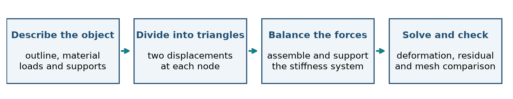
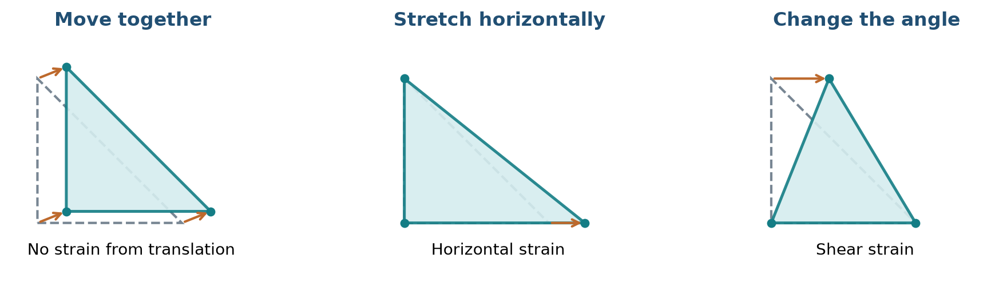
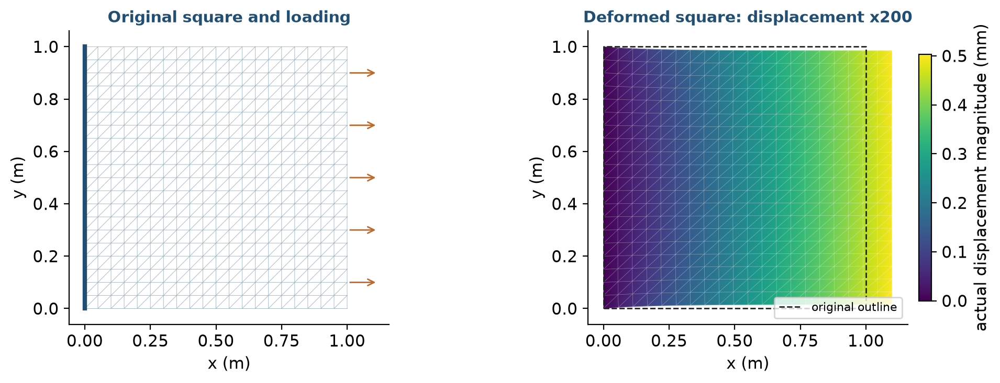
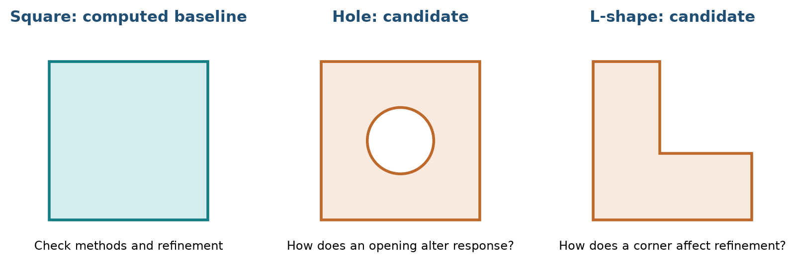
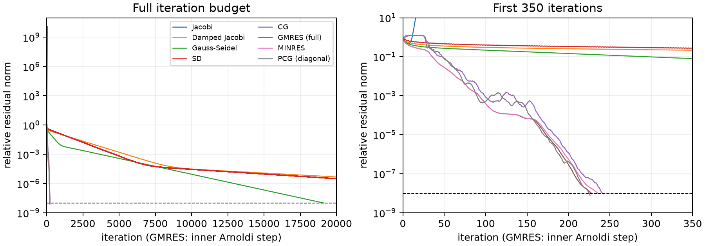
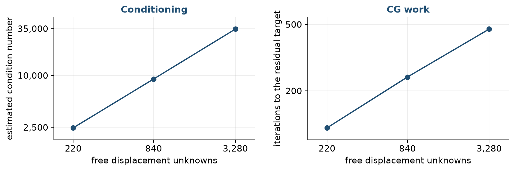

# Elastic Deformation of Two-Dimensional Objects

**Group 02 | NLA-1/NLA-2 | Progress report for discussion | Updated 10 November 2026**

Ernesto Corral, Simon Felix Eberhagen, Pablo Pérez González, Lucas Portela Almonte, Darius-Andrei Vulturu

Numerical Linear Algebra, Bachelor in Applied Mathematics, Fall 2026. Professor Ignacio Zubizarreta.

### Abstract

We study how a two-dimensional elastic object changes shape under a load, and how to solve the resulting system of equations efficiently. We begin with an intuitive model, divide the object into triangles, and obtain a sparse stiffness matrix. Completed calculations concern a square plate: a small direct solve, eight iterative methods, and three mesh resolutions. Conjugate gradients reaches the target in 242 iterations on the 840-unknown system; ordinary Jacobi diverges. Equilibrium checks and an exact verification case support the implementation. Further geometries, loading studies and stronger preconditioners remain proposed work. This report records progress and open decisions, rather than a completed investigation.

## 1. Project aim and building the model

We study how the geometry of a two-dimensional elastic object and its supports affect its response to applied forces. Our unknown is the displacement $\mathbf{u}(x,y)$, which tells us how far each point moves horizontally and vertically. Differences in movement between nearby points describe local stretching and shearing, called strain. The material resists these changes through internal forces per unit area, called stress. We assume small deformations and a linear relation between strain and stress, leaving the material choice to the individual cases [3].



Our questions are: how do shape, loading and supports change displacement; which properties of the matrix explain solver behaviour; and how does refining the mesh change the answer and its cost? The current square provides a controlled starting point. Material values used there are benchmark choices, not decisions for every future object.

**Progress at a glance.** Completed: triangular-element assembly for structured square meshes, support elimination, small direct solves, iterative comparisons, initial refinement and validation. Still open: the final set of objects, broader load/support comparisons, constrained Delaunay meshes, stronger preconditioning and the final experimental scope [1,2].

<!-- pagebreak -->

### From a continuous object to a finite set of unknowns

We look for the shape after the object has settled under the load. Forces must then balance in both directions throughout the material:

$$
\frac{\partial\sigma_{xx}}{\partial x}+\frac{\partial\sigma_{xy}}{\partial y}+g_x=0,\qquad \frac{\partial\sigma_{xy}}{\partial x}+\frac{\partial\sigma_{yy}}{\partial y}+g_y=0.
$$

Here the $\sigma$ terms are stress components and $g_x,g_y$ are applied forces per unit volume. Since stress depends on strain, and strain depends on displacement, these equations determine $\mathbf{u}$ together with the loads and support conditions [3].

To make this a finite problem, we divide the region into filled triangles, following its boundary and leaving any holes empty. Their vertices are the mesh nodes, each with two displacement components. Inside each triangle, displacement varies linearly between its three vertex values. Adjacent triangles share these values, so their displacements agree along the common edge. The triangles represent filled material; their edges are not physical bars. Smaller triangles allow more variation in the deformation.

![Figure 2. The illustration from the agreed opening. Triangles cover the solid and share nodes. This outline illustrates the modelling idea; it is not a selected experimental object or evidence of a completed general mesher. Boundary-respecting triangulation is planned using Triangle [4].](modules/01-building-model/figures/triangulation.png)

The finite element method balances internal and external work: forces acting through small allowed displacements. Adding triangle contributions at shared nodes gives $Kd=f+r$. Here $d$ collects the node displacements, $f$ contains applied nodal forces, and $r$ contains support reactions. The stiffness matrix $K$ describes how the mesh and material resist displacement.

We split displacements into unknown values $F$ and prescribed support values $C$. The free equations become

$$
Ax=b,\qquad A=K_{FF},\quad x=d_F,\quad b=f_F-K_{FC}d_C.
$$

For fixed supports, $d_C=0$ and $b=f_F$. Supports must prevent each separate piece from freely sliding or turning. Solving this reduced system gives the displacements used to draw the deformed object.

<!-- pagebreak -->

## 2. Displacement, forces and the stiffness matrix

Moving every point by the same amount changes position without stretching the material. Strain measures differences in movement. Figure 3 separates three ideas before introducing the formulas; its exaggerated drawings are schematic.



Writing horizontal displacement as $u$ and vertical displacement as $v$, the small-strain components are

$$
\epsilon_{xx}=\partial_xu,\qquad \epsilon_{yy}=\partial_yv,\qquad \gamma_{xy}=\partial_yu+\partial_xv.
$$

For the current thin plate, we use **plane stress**: out-of-plane stress is neglected. Young's modulus $E$ describes stiffness, while Poisson ratio $\nu$ describes the connection between extension and transverse contraction. For a homogeneous isotropic material,

$$
\sigma_{xx}=\frac{E(\epsilon_{xx}+\nu\epsilon_{yy})}{1-\nu^2},\quad \sigma_{yy}=\frac{E(\nu\epsilon_{xx}+\epsilon_{yy})}{1-\nu^2},\quad \sigma_{xy}=\frac{E\gamma_{xy}}{2(1+\nu)}.
$$

Let $B_e$ convert the six displacement values on triangle $e$ into strain, and let $D$ contain the stress-strain law above. A triangle of area $|T_e|$ and thickness $t$ contributes

$$
K_e=t|T_e|B_e^TDB_e,\qquad K=\sum_e R_e^TK_eR_e.
$$

The mapping $R_e$ selects that triangle's entries from the global vector. Assembly adds contributions where triangles share nodes. Only nodes sharing a triangle interact directly, so most matrix entries are zero: this is **sparsity**.

The unsupported matrix has zero-energy translations and rotation. With physically admissible elastic parameters, a valid connected mesh and supports removing these motions, the reduced matrix $A$ is **symmetric positive definite (SPD)**: $z^TAz>0$ for every nonzero free displacement vector $z$. This means an allowed deformation stores positive elastic energy. It permits Cholesky and conjugate gradients, but does not guarantee ordinary Jacobi convergence. The **condition number** measures worst-case amplification of relative load changes into relative displacement changes; it is investigated in Section 6.

Support forces are recovered afterwards as $(Kd-f)_C$. Retaining the original system is essential for checking equilibrium. A small residual in the reduced system checks free-node balance; checking reactions also tests the load/support treatment.

<!-- pagebreak -->

## 3. Numerical methods and comparison strategy

For a small system, a factorization gives a direct route to the solution. For a larger sparse system, iterative methods improve a starting guess while using matrix-vector products or simpler triangular solves. Each iteration improves an approximation to **static equilibrium**; it is not a physical time step.

| Family | What it does | Role in this progress report |
| --- | --- | --- |
| LU and Cholesky | Factor the matrix and solve triangular systems. | Direct small example; sparse LU supplies the large-system reference. |
| Jacobi and Gauss-Seidel | Correct each displacement using diagonal or triangular equations. | Simple baselines; show that matrix properties affect convergence. |
| Steepest descent (SD) | Follow the residual with an energy-minimizing step. | Compare a simple descent rule with CG. |
| Conjugate gradients (CG) | Combine directions using symmetry and positive definiteness [5,6]. | Main iterative baseline for this reduced matrix. |
| GMRES and MINRES | Build search spaces adapted to general or symmetric matrices [6]. | Additional comparisons; full GMRES here has a growing basis. |
| Preconditioned CG (PCG) | Rescale the problem before applying CG. | Diagonal scaling tested; stronger SPD choices remain open. |

All methods receive the same $A,b$ and a zero initial guess. We accept a solution only when its independently evaluated relative residual satisfies

$$
\eta(x)=\frac{\|b-Ax\|_2}{\|b\|_2}<10^{-8}.
$$

The budget is 20,000 iterations. Ordinary Jacobi stops earlier if its relative residual exceeds $10^{10}$. Damped Jacobi uses relaxation 0.5. Diagonal PCG uses $M=\operatorname{diag}(A)$. A failed target remains a failed target even if the run is short.

We also report $\|x-x_{LU}\|_2/\|x_{LU}\|_2$, measuring disagreement with sparse LU on the **same mesh**. This is solver error relative to a numerical reference. Discretization error asks how well the mesh represents the continuous object; solver agreement alone cannot answer that question.

**Timing scope.** Times are saved best-of-three measurements of these implementations. They include method setup inside the solve and required stopping checks, but exclude assembly, matrix diagnostics, construction of the LU reference and separately collected histories. Sparse LU is an **untimed reference**, so this table cannot rank direct and iterative runtimes. The recorded environment is Python 3.13.16, NumPy 2.5.4 and SciPy 1.18.1 on macOS ARM64.

**Stopping details.** MINRES uses a true-residual callback because its native criterion differs. GMRES counts inner Arnoldi steps with restart length 840; its plotted history is an Arnoldi residual estimate. Final acceptance always uses the true residual. Details and raw statuses remain in `solvers/progress_benchmark.py` and `drafts/results/benchmark.json`.

<!-- pagebreak -->

## 4. A simple square benchmark

The ordered boundary is (0,0), (1,0), (1,1), (0,1), in metres. The left edge is fixed in both directions; the right edge carries horizontal traction $p=100$ MPa; top and bottom are free. We use $E=200$ GPa, $\nu=0.3$, $t=0.01$ m and no body force. These settings define the completed benchmark, rather than a final choice for all objects.


With two cells per side there are 9 nodes, 8 triangles and 12 free unknowns. A loaded segment of length $\ell$ contributes $pt\ell/2$ to each endpoint. Thus the total force stays $ptL=10^6$ N under refinement. The reduced load is

$$
b=250000(0,0,1,0,0,0,2,0,0,0,1,0)^T\ \mathrm{N}.
$$

Pivoted LU, an explicit inverse and Cholesky give relative residuals $5.81\times10^{-16}$, $6.85\times10^{-16}$ and $7.42\times10^{-16}$. The full $A,b,x$ are provided in `drafts/results/small_*.csv`. The condition number is 95.799. Inverting is included for the small exercise; the larger case uses sparse solves.



The maximum right-edge horizontal displacement is 0.4967 mm, close to the dimensional estimate $pL/E=0.5$ mm. The plate extends and contracts transversely. A shared triangle diagonal can bias coarse-mesh symmetry; reflected meshes remain a planned check. The separate prescribed-grip case is not mixed into these force-driven results.

<!-- pagebreak -->

## 5. Additional objects and proposed experiments

The square establishes a baseline before changing the geometry. Figure 6 shows **candidates**, not an agreed final set or completed simulations. Their exact dimensions, boundary coordinates, support positions and comparable load definitions still need to be settled.



| Comparison | Question to investigate | Status and controlled choices |
| --- | --- | --- |
| Geometry and holes | How does removing or reshaping material alter displacement and the matrix? | Proposed: choose outlines, supports and load convention; generate boundary-respecting meshes. |
| Mesh resolution | How much does displacement change, and what happens to conditioning and solver cost? | Three square meshes completed; matched-point/field error study remains open. |
| Load magnitude and location | Does displacement scale with force, and how does relocating a load alter response? | Basic linearity checks exist; broader location/magnitude experiments remain planned. |
| Supports | How does restraining different movements change the solution? | Clamp baseline and roller verification completed; systematic comparison remains planned. |
| Material and thickness | How do $E$ and $t$ change displacement under a stated load convention? | Analytical predictions below; no new parameter-sweep results claimed. |

**Material and thickness: predictions to test.** For fixed geometry, $\nu$, thickness, zero prescribed support displacements and applied force vector, scaling $E$ by $\alpha$ scales $A$ by $\alpha$ and displacement by $1/\alpha$. Uniform scaling leaves the condition number unchanged. More displacement therefore does not by itself imply a harder linear system.

For a uniform thickness change, $A$ scales with $t$. Under fixed total force this predicts displacement proportional to $1/t$. Under fixed traction in Pa, the assembled boundary force also scales with $t$, so thickness cancels from the in-plane plane-stress displacement. The current `force_driven` function holds traction $p$ fixed unless adjusted. We must choose the convention before interpreting a thickness study.

The local square assembly is implemented and checked. General constrained Delaunay meshing with holes is still planned [4]. We also need to locate the professor's provided assembly routine and decide how to compare it with our implementation. These are explicit progress-report questions, rather than silently settled choices.

<!-- pagebreak -->

## 6. Initial results, validation and discussion

**Table 1. Saved results for the same 840-unknown force-driven square.** Error is relative to same-mesh LU. Times are historical best-of-three measurements in milliseconds. An asterisk marks an unmet residual target.

| Method | Iterations | Relative residual | Error vs LU | Time (ms) |
| --- | ---: | ---: | ---: | ---: |
| Jacobi* | 49 | 1.32e10 | 3.38e7 | 0.36 |
| Damped Jacobi* | 20,000 | 4.76e-6 | 8.73e-5 | 203 |
| Gauss-Seidel | 19,136 | 9.9963e-9 | 1.74e-7 | 3,629 |
| SD* | 20,000 | 3.08e-6 | 4.22e-5 | 324 |
| CG | 242 | 9.41e-9 | 9.77e-10 | 3.52 |
| Full GMRES | 228 | 9.48e-9 | 5.97e-9 | 74.7 |
| MINRES | 236 | 9.45e-9 | 5.94e-9 | 5.90 |
| Diagonal PCG | 226 | 8.01e-9 | 4.81e-10 | 3.37 |



CG reaches the target with far fewer iterations than Gauss-Seidel. Full GMRES uses fewer iterations than CG but costs more here because it maintains a growing search basis. Diagonal preconditioning reduces CG from 242 to 226 iterations, about 7%; these short timings do not establish a reliable speed advantage between the two.

Ordinary Jacobi diverges, matching its estimated iteration-matrix spectral radius of 1.96005. Damping by 0.5 is within the calculated convergence range, but damped Jacobi and SD miss the target within 20,000 steps. The older uncapped SD result of 46,030 iterations belongs to another stopping protocol and is not substituted here. A short failed run is not evidence of an efficient solve.

<!-- pagebreak -->

### Refinement: better representation, harder equations

**Table 2. Same material, clamp and distributed traction on three square meshes.** Displacement is measured at the same physical top-right corner. Condition numbers are estimated from extreme eigenvalues.

| Cells per side | Unknowns | Condition number | CG iterations | Corner u (mm) |
| ---: | ---: | ---: | ---: | ---: |
| 10 | 220 | 2,469.5 | 120 | 0.493849 |
| 20 | 840 | 9,103.9 | 242 | 0.495509 |
| 40 | 3,280 | 34,547.7 | 469 | 0.496073 |



The corner displacement changes by 0.001660 mm, then 0.000564 mm. This suggests decreasing mesh dependence for this observable; it does not yet establish continuum error or a convergence order. The 840-unknown matrix stores 11,112 entries in compressed sparse row (CSR) format, including explicit zeros; 9,590 are numerically nonzero under the recorded cutoff.

**Validation of the clamped case, using the LU reference.**

| Check | Saved result |
| --- | ---: |
| Horizontal / vertical force imbalance | -1.20e-9 / -1.64e-9 N |
| Moment imbalance about (0,0) | 3.34e-9 N m |
| Maximum displacement at fixed supports | 0 m |
| Relative residual of sparse LU | 3.38e-14 |

Imbalances include applied forces and support reactions, and are tiny compared with the $10^6$ N load. A separate roller-and-pin support case has the exact displacement $u=px/E$, $v=-\nu py/E$; its saved relative error is $2.50\times10^{-15}$. This checks assembly and constraints, rather than measuring discretization error of the clamped case.

A seeded random perturbation of the reduced load, of relative size $10^{-6}$, changes displacement by $4.51\times10^{-7}$. This is one algebraic sensitivity test, including interior force entries. The worst-case bound $\|\delta x\|/\|x\|\leq\kappa_2(A)\|\delta b\|/\|b\|$ is about 0.00910 here; a random direction need not approach it.

<!-- pagebreak -->

## 7. Preliminary conclusions and next steps

The square gives us a working route from loads and supports to a sparse system and a checked displacement field. Removing rigid motions makes this reduced matrix suitable for CG and Cholesky. CG is an effective iterative baseline in the saved comparison, while diagonal preconditioning offers only modest improvement. Refinement changes displacement less over successive meshes but increases conditioning and iterations. These conclusions apply to the tested cases; we have not yet established a preferred solver for all geometries or an adequate final mesh resolution.

### Questions for feedback and team decisions

- Where is the provided FEM assembly routine, and may our checked implementation remain the baseline meanwhile?
- Which additional object gives the clearest comparison within the remaining time: a hole, a concave outline, or another agreed geometry?
- Should thickness comparisons keep total force or traction fixed? Which load/support variations should receive priority?
- Are the equilibrium and exact roller checks a sufficient starting point for a matched-point mesh-error study?
- How much final-report space should go to stronger SPD preconditioning versus broader physical cases? The current solver set is a progress comparison, not a final commitment.

### Work plan through submission and presentation preparation

**Table 3. Proposed schedule; task ownership needs team confirmation.**

| Dates | Output | Coordination to confirm |
| --- | --- | --- |
| 10-12 Nov | Review this progress report; locate assembly routine; choose a small set of final comparisons. | All five members; Simon/Hermes on model coordination, Lucas on numerical feasibility. |
| 12-15 Nov | Add chosen boundary-respecting meshes and load/support cases; validate load totals and constraints. | Geometry owner to agree; Lucas integrates matrix/solver checks. |
| 15-17 Nov | Compare stronger SPD preconditioning and mesh changes at common physical points; separate setup/solve costs. | Lucas on numerical implementation; team checks interpretation. |
| 17-20 Nov | Complete and rerun one self-contained notebook; transfer report to the required Overleaf template; review citations and contributions; submit by 20 Nov. | All five members review; one human submits. |
| 21-24 Nov | Prepare visual presentation and practise each member's explanation and questions. | All five members; presentation and notebook due 27 Nov. |

The final report must use `clean,onecolumn` and fit within 10 pages including title and references, with appendices excluded [2]. This progress PDF uses a standalone review layout. Outstanding work also includes mirrored-mesh checks, broader loading studies and careful treatment of clamp/free-edge junctions; no stress-convergence claim is made.

<!-- pagebreak -->

### Sources and reproducibility

This document reorganizes the existing progress draft and saved results; no new solver timings or parameter-sweep outcomes were generated for this revision. Tables 1-2 and the validation values come from `drafts/results/benchmark.json`, `solver_comparison.csv` and `histories.json`, produced by `solvers/progress_benchmark.py`. Figures 1, 3-6 and 8 are generated by `drafts/make_visual_progress_figures.py`; Figures 4 and 8 use saved data. Figure 5 uses one untimed baseline solve, checked against the saved maximum displacement. The opening and Figure 2 come from `drafts/modules/01-building-model/`.

To rebuild the explanatory figures and PDF from the repository root, install the project dependencies, then run:

```text
python drafts/make_visual_progress_figures.py
python drafts/build_visual_progress.py
```

To recompute experiments, use `python solvers/progress_benchmark.py`. Existing implementation checks are `fem/check_fem.py`, `solvers/check_system_tools.py` and `solvers/check_sparse_system_tools.py`. Rerunning benchmarks replaces saved measurements; the review build only reads them.

### Contributions and AI-use disclosure

The repository credits Ernesto's model/force-driven notes and the existing FEM implementation associated with Frambuesa and Ernesto. Darius's prescribed-grip case remains separate. Simon/Hermes coordinated the model and report structure. Lucas's Codex produced the prior benchmark consolidation and this visual progress revision from repository sources. Each human should confirm their specific contribution; completed contributions by Pablo are not established by the available files, and proposed review tasks are not claimed as completed work.

AI agents assisted with formulation, implementation, numerical checking, figures and writing. This revision adapts the agreed opening, reorganizes existing results and adds explanatory diagrams. The human authors remain responsible for checking the content and complying with the course's AI policy.

### References

[1] I. Zubizarreta and L. Álvaro Gómez, *NLA and PDEs: Group Project Descriptions*, Fall 2026, NLA-1/NLA-2, p. 2; I. Zubizarreta, *Session 22: Lab 5 Develop Project Draft*, Fall 2026. Course materials.

[2] I. Zubizarreta and L. Álvaro Gómez, *Group Project Guidelines: Numerical Linear Algebra and Partial Differential Equations*, Fall 2026, pp. 1-2. Course materials.

[3] A. Logg and H. P. Langtangen, *The Equations of Linear Elasticity*, FEniCSx tutorial maintained by J. S. Dokken. https://jsdokken.com/dolfinx-tutorial/chapter2/linearelasticity.html (accessed 10 November 2026).

[4] J. R. Shewchuk, *Triangle: Generating Delaunay Triangulations*, Carnegie Mellon University. https://www.cs.cmu.edu/~quake/triangle.delaunay.html (accessed 10 November 2026).

[5] J. R. Shewchuk, *An Introduction to the Conjugate Gradient Method Without the Agonizing Pain*, edition 1 1/4, Carnegie Mellon University, 4 August 1994. https://www.cs.cmu.edu/~quake-papers/painless-conjugate-gradient.pdf.

[6] SciPy community, *cg*, *gmres* and *minres*, SciPy reference documentation. https://docs.scipy.org/doc/scipy/reference/sparse.linalg.html (accessed 10 November 2026). API details are implemented and recorded in the repository benchmark.
